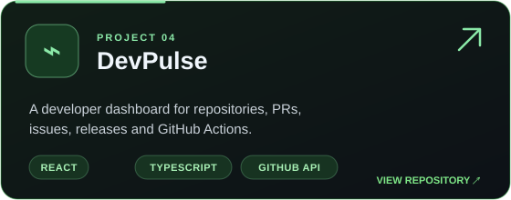

<div align="center">


<br>


<p>
  <a href="https://github.com/koushik4475"></a>
  <a href="https://www.linkedin.com/in/koushikhy"></a>
  <a href="https://koushikhy.netlify.app"></a>
  <a href="mailto:koushik4475@gmail.com"></a>
</p>

<a href="https://github.com/koushik4475">
  
</a>

</div>

---

## 👋 About Me


I'm a **Feature Engineer at Equiwiz Software Solutions**. I build product features that are usable, maintainable, and dependable, and I like turning rough ideas into tools people actually use.

- 🧩 Product engineering, usability, and maintainable implementation
- ⚙️ Workflow automation, integrations, and developer tooling
- 📱 Mobile, cross-platform, and offline-first applications
- 🧠 AI/ML, computer vision, and practical experimentation
- 🚀 Turning ideas into real, working software

```ts
const koushik = {
  role: "Feature Engineer @ Equiwiz Software Solutions",
  building: ["offline-first apps", "local-first web tools", "developer dashboards"],
  exploring: ["AI/ML", "computer vision", "workflow automation"],
  openTo: ["product work", "open source", "developer tooling"],
};
```

<br clear="right" />

---

## 🧰 Tech Stack

<div align="center">

<p align="center">
  <picture>
  <source media="(prefers-color-scheme: dark)" srcset="./assets/badges/dart.dark.svg" />
  
</picture>
  <picture>
  <source media="(prefers-color-scheme: dark)" srcset="./assets/badges/flutter.dark.svg" />
  
</picture>
  <picture>
  <source media="(prefers-color-scheme: dark)" srcset="./assets/badges/typescript.dark.svg" />
  
</picture>
  <picture>
  <source media="(prefers-color-scheme: dark)" srcset="./assets/badges/javascript.dark.svg" />
  
</picture>
  <picture>
  <source media="(prefers-color-scheme: dark)" srcset="./assets/badges/react.dark.svg" />
  
</picture>
  <picture>
  <source media="(prefers-color-scheme: dark)" srcset="./assets/badges/python.dark.svg" />
  
</picture>
</p>
<p align="center">
  <picture>
  <source media="(prefers-color-scheme: dark)" srcset="./assets/badges/sqlite.dark.svg" />
  
</picture>
  <picture>
  <source media="(prefers-color-scheme: dark)" srcset="./assets/badges/mysql.dark.svg" />
  
</picture>
  <picture>
  <source media="(prefers-color-scheme: dark)" srcset="./assets/badges/indexeddb.dark.svg" />
  
</picture>
  <picture>
  <source media="(prefers-color-scheme: dark)" srcset="./assets/badges/drift.dark.svg" />
  
</picture>
  <picture>
  <source media="(prefers-color-scheme: dark)" srcset="./assets/badges/riverpod.dark.svg" />
  
</picture>
</p>
<p align="center">
  <picture>
  <source media="(prefers-color-scheme: dark)" srcset="./assets/badges/git.dark.svg" />
  
</picture>
  <picture>
  <source media="(prefers-color-scheme: dark)" srcset="./assets/badges/github-actions.dark.svg" />
  
</picture>
  <picture>
  <source media="(prefers-color-scheme: dark)" srcset="./assets/badges/vite.dark.svg" />
  
</picture>
  <picture>
  <source media="(prefers-color-scheme: dark)" srcset="./assets/badges/vitest.dark.svg" />
  
</picture>
  <picture>
  <source media="(prefers-color-scheme: dark)" srcset="./assets/badges/playwright.dark.svg" />
  
</picture>
  <picture>
  <source media="(prefers-color-scheme: dark)" srcset="./assets/badges/docker.dark.svg" />
  
</picture>
</p>

</div>

<sub>Technology badges are generated as SVGs and stored in this repository. They use brand glyphs where available and do not depend on Shields.io at render time.</sub>

---

## 🚀 Featured Projects

<table>
<tr>
<td width="50%" valign="top">

<a href="https://github.com/koushik4475/pageclock"></a>

</td>
<td width="50%" valign="top">

<a href="https://github.com/koushik4475/lifedesk"></a>

</td>
</tr>
<tr>
<td width="50%" valign="top">

<a href="https://github.com/koushik4475/secondbrain"></a>

</td>
<td width="50%" valign="top">

<a href="https://github.com/koushik4475/devpulse"></a>

</td>
</tr>
<tr>
<td width="50%" valign="top">

<a href="https://github.com/koushik4475/subtrack"></a>

</td>
<td width="50%" valign="middle">

### 🌱 More projects

I also build experiments across mobile apps, web tools, workflow automation, and AI-assisted development.

[**Browse all repositories →**](https://github.com/koushik4475?tab=repositories)

</td>
</tr>
</table>

---

## 📊 GitHub Stats & Activity

<div align="center">

<picture>
  <source media="(prefers-color-scheme: dark)" srcset="./assets/overview.dark.svg" />
  
</picture>

<table>
<tr>
<td width="50%" valign="top">

<picture>
  <source media="(prefers-color-scheme: dark)" srcset="./assets/contributions.dark.svg" />
  
</picture>

</td>
<td width="50%" valign="top">

<picture>
  <source media="(prefers-color-scheme: dark)" srcset="./assets/languages.dark.svg" />
  
</picture>

</td>
</tr>
</table>

<sub>Generated from GitHub data and refreshed every day by GitHub Actions. Cards are stored in this repository.</sub>

### 🐍 Contribution Snake

<picture>
  <source media="(prefers-color-scheme: dark)" srcset="https://raw.githubusercontent.com/koushik4475/koushik4475/output/github-snake-dark.svg" />
  <source media="(prefers-color-scheme: light)" srcset="https://raw.githubusercontent.com/koushik4475/koushik4475/output/github-snake.svg" />
  
</picture>

</div>

---

## 🤝 Let's Connect

<div align="center">

**Open to:** product engineering · open-source collaboration · developer tooling

<p>
  <a href="https://github.com/koushik4475"></a>
  <a href="https://www.linkedin.com/in/koushikhy"></a>
  <a href="https://koushikhy.netlify.app"></a>
  <a href="mailto:koushik4475@gmail.com"></a>
</p>


<br><br>
⭐️ From [@koushik4475](https://github.com/koushik4475) · **Building the future, one commit at a time** 🚀

</div>
