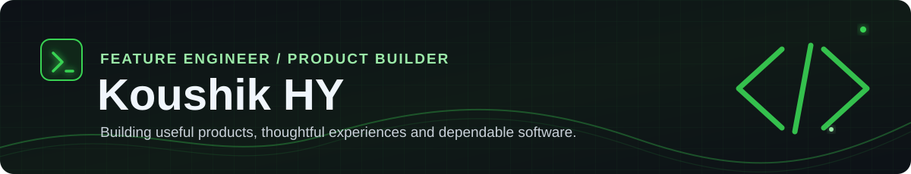
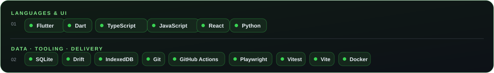
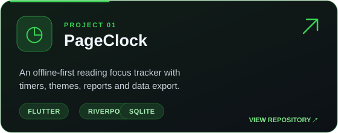
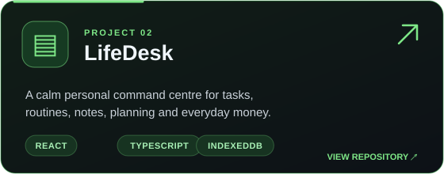
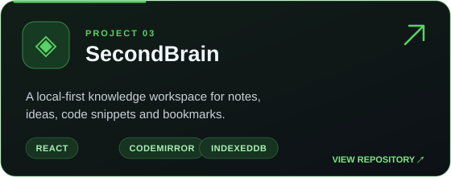
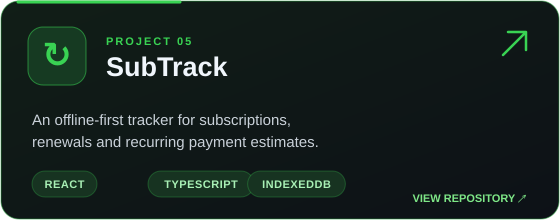

  
  
  
  

---

## 👋 About Me

I'm a **Feature Engineer at Equiwiz Software Solutions**, focused on building useful product features and dependable software.

I enjoy working across mobile, web, and developer tooling—especially when a project can make everyday work simpler.

- 🧩 Product engineering, usability, and maintainable implementation
- ⚙️ Workflow automation, integrations, and developer tooling
- 📱 Mobile, cross-platform, and offline-first applications
- 🧠 AI/ML, computer vision, and practical experimentation
- 🚀 Turning ideas into real, working software

 

---

## 🧰 Tech Stack

---

## 🚀 Featured Projects

<table>
<tr>
<td width="50%" valign="top">

</td>
<td width="50%" valign="top">

</td>
</tr>
<tr>
<td width="50%" valign="top">

</td>
<td width="50%" valign="top">

</td>
</tr>
<tr>
<td width="50%" valign="top">

</td>
<td width="50%" valign="middle">

### 🌱 More projects

I also build experiments across mobile apps, web tools, workflow automation, and AI-assisted development.

[**Browse all repositories →**](https://github.com/koushik4475?tab=repositories)

</td>
</tr>
</table>

---

## 📊 GitHub Stats & Activity

<picture>
  <source media="(prefers-color-scheme: dark)" srcset="./assets/cards.dark.svg" />
  
</picture>

Generated from GitHub and refreshed automatically every day.

### 🐍 Contribution Snake

<picture>
  <source media="(prefers-color-scheme: dark)" srcset="https://raw.githubusercontent.com/koushik4475/koushik4475/output/github-snake-dark.svg" />
  <source media="(prefers-color-scheme: light)" srcset="https://raw.githubusercontent.com/koushik4475/koushik4475/output/github-snake.svg" />
  
</picture>

---

## 🤝 Let's Connect

**Open to:** product engineering · open-source collaboration · developer tooling

  

⭐️ From [@koushik4475](https://github.com/koushik4475) · **Building the future, one commit at a time** 🚀

