<table>
<tr>
<td width="30%" align="center" valign="middle">
  
</td>
<td width="70%" valign="middle">

<h1>Hi, I'm Koushik HY 👋</h1>
<h3>Feature Engineer · Product Builder · Open Source Enthusiast</h3>

I build practical software, shape product experiences, and automate workflows. I enjoy working across mobile, web, and developer tools — turning ideas into useful, reliable products.

  
  
  
  

</td>
</tr>
</table>

---

## 💚 About Me

I'm a **Feature Engineer at Equiwiz Software Solutions**, working on product engineering and building software that solves practical problems.

- 🧩 Product features, user experience, and maintainable implementation
- ⚙️ Workflow automation, integrations, and developer tooling
- 📱 Mobile and cross-platform application development
- 🌐 Web applications and local-first product experiences
- 🧠 Interested in AI/ML, computer vision, and useful developer tools

## 🛠️ Tech Stack

**Languages & UI**

**Data, Testing & Delivery**

## 🚀 Featured Projects

<table>
<tr>
<td width="50%" valign="top">

### ⏱️ [PageClock](https://github.com/koushik4475/pageclock)

An offline-first reading focus tracker with focus sessions, timer experiences, themes, and data export.

**Built with:** Flutter · Riverpod · Drift · SQLite

[Repository](https://github.com/koushik4475/pageclock)

</td>
<td width="50%" valign="top">

### 🗂️ [LifeDesk](https://github.com/koushik4475/lifedesk)

A local-first personal command centre for tasks, routines, notes, planning, everyday money, and important dates.

**Built with:** React · TypeScript · Vite · IndexedDB

[Repository](https://github.com/koushik4475/lifedesk)

</td>
</tr>
<tr>
<td width="50%" valign="top">

### 🧠 [SecondBrain](https://github.com/koushik4475/secondbrain)

A local-first knowledge workspace for notes, ideas, meeting notes, learning material, code snippets, and bookmarks.

**Built with:** React · TypeScript · IndexedDB

[Repository](https://github.com/koushik4475/secondbrain)

</td>
<td width="50%" valign="top">

### 📊 [DevPulse](https://github.com/koushik4475/devpulse)

A developer dashboard for monitoring public GitHub repositories, pull requests, issues, releases, and Actions runs.

**Built with:** React · TypeScript · Vite · GitHub API

[Repository](https://github.com/koushik4475/devpulse)

</td>
</tr>
<tr>
<td width="50%" valign="top">

### 🔔 [SubTrack](https://github.com/koushik4475/subtrack)

An offline-first subscription and recurring-payment tracker with renewal views, spending estimates, and local data export.

**Built with:** React · TypeScript · Vite · IndexedDB

[Repository](https://github.com/koushik4475/subtrack)

</td>
<td width="50%" valign="top">

### 🌱 More experiments

I also maintain smaller experiments and tools across web development, automation, mobile apps, and AI-assisted workflows.

[Explore all repositories](https://github.com/koushik4475?tab=repositories)

</td>
</tr>
</table>

## 📈 GitHub Activity

<picture>
  <source media="(prefers-color-scheme: dark)" srcset="./assets/cards.dark.svg" />
  
</picture>

These cards are generated and stored in this repository by GitHub Actions, with a daily refresh schedule.

## 🤝 Let's Connect

<a href="https://github.com/koushik4475">GitHub</a>
&nbsp; · &nbsp;
<a href="https://www.linkedin.com/in/koushikhy">LinkedIn</a>
&nbsp; · &nbsp;
<a href="https://koushikhy.netlify.app">Portfolio</a>
&nbsp; · &nbsp;
<a href="mailto:koushik4475@gmail.com">Email</a>

  

> *“Code is like humor. When you have to explain it, it's bad.”*  
> **— Cory House**

 

⭐️ From [@koushik4475](https://github.com/koushik4475) · **Building the future, one commit at a time** 🚀

