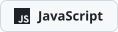

"
  width="100%" alt="Photorealistic neon-lit developer workspace banner for Koushik HY" />

<strong>Offline-first apps</strong> &nbsp;·&nbsp; <strong>Local-first tools</strong> &nbsp;·&nbsp; <strong>Developer workflows</strong>

  
  
  
  

---

<h1 align="center">Koushik HY | Feature Engineer & Product Builder</h1>

Feature Engineer building offline-first mobile apps, local-first web products, developer tools, workflow automation, and practical AI/ML projects.

<h2 align="center">👋 About Me</h2>

  

  <strong>-----------------------------------------</strong> 
  Building practical product features and dependable software.

I enjoy turning rough ideas into tools people actually use, working across mobile, web, and developer tooling.

  <code>PRODUCT ENGINEERING</code> &nbsp;
  <code>WORKFLOW AUTOMATION</code> &nbsp;
  <code>MOBILE + WEB</code> &nbsp;
  <code>AI / COMPUTER VISION</code>

---

## 🧰 Tech Stack

  <picture>
  <source media="(prefers-color-scheme: dark)" srcset="./assets/badges/dart.dark.svg" />
  
</picture>
  <picture>
  <source media="(prefers-color-scheme: dark)" srcset="./assets/badges/flutter.dark.svg" />
  
</picture>
  <picture>
  <source media="(prefers-color-scheme: dark)" srcset="./assets/badges/typescript.dark.svg" />
  
</picture>
  <picture>
  <source media="(prefers-color-scheme: dark)" srcset="./assets/badges/javascript.dark.svg" />
  
</picture>
  <picture>
  <source media="(prefers-color-scheme: dark)" srcset="./assets/badges/react.dark.svg" />
  
</picture>
  <picture>
  <source media="(prefers-color-scheme: dark)" srcset="./assets/badges/python.dark.svg" />
  
</picture>

  <picture>
  <source media="(prefers-color-scheme: dark)" srcset="./assets/badges/sqlite.dark.svg" />
  
</picture>
  <picture>
  <source media="(prefers-color-scheme: dark)" srcset="./assets/badges/mysql.dark.svg" />
  
</picture>
  <picture>
  <source media="(prefers-color-scheme: dark)" srcset="./assets/badges/indexeddb.dark.svg" />
  
</picture>
  <picture>
  <source media="(prefers-color-scheme: dark)" srcset="./assets/badges/drift.dark.svg" />
  
</picture>
  <picture>
  <source media="(prefers-color-scheme: dark)" srcset="./assets/badges/riverpod.dark.svg" />
  
</picture>

  <picture>
  <source media="(prefers-color-scheme: dark)" srcset="./assets/badges/git.dark.svg" />
  
</picture>
  <picture>
  <source media="(prefers-color-scheme: dark)" srcset="./assets/badges/github-actions.dark.svg" />
  
</picture>
  <picture>
  <source media="(prefers-color-scheme: dark)" srcset="./assets/badges/vite.dark.svg" />
  
</picture>
  <picture>
  <source media="(prefers-color-scheme: dark)" srcset="./assets/badges/vitest.dark.svg" />
  
</picture>
  <picture>
  <source media="(prefers-color-scheme: dark)" srcset="./assets/badges/playwright.dark.svg" />
  
</picture>
  <picture>
  <source media="(prefers-color-scheme: dark)" srcset="./assets/badges/docker.dark.svg" />
  
</picture>

Technology badges are generated and stored in this repository. They use brand glyphs where available and do not depend on Shields.io when the profile renders.

---

## 🚀 Featured Projects

<table>
<tr>
<td width="50%" valign="top">

</td>
<td width="50%" valign="top">

</td>
</tr>
<tr>
<td width="50%" valign="top">

</td>
<td width="50%" valign="top">

</td>
</tr>
<tr>
<td width="50%" valign="top">

</td>
<td width="50%" valign="middle">

### 🌱 More projects

I also experiment with mobile apps, web tools, workflow automation, and AI-assisted development.

[**Browse all repositories →**](https://github.com/koushik4475?tab=repositories)

</td>
</tr>
</table>

---

## 📊 GitHub Activity

<picture>
  <source media="(prefers-color-scheme: dark)" srcset="./assets/overview.dark.svg" />
  
</picture>

<picture>
  <source media="(prefers-color-scheme: dark)" srcset="./assets/contributions.dark.svg" />
  
</picture>

<picture>
  <source media="(prefers-color-scheme: dark)" srcset="./assets/languages.dark.svg" />
  
</picture>

These cards are generated from GitHub data and refreshed automatically by GitHub Actions.

### 🐍 Contribution Snake

<picture>
  <source media="(prefers-color-scheme: dark)" srcset="https://raw.githubusercontent.com/koushik4475/koushik4475/output/github-snake-dark.svg" />
  <source media="(prefers-color-scheme: light)" srcset="https://raw.githubusercontent.com/koushik4475/koushik4475/output/github-snake.svg" />
  
</picture>

---

## 🤝 Let's Connect

**Open to:** product engineering · open-source collaboration · developer tooling

  
  
  
  

  
⭐️ From [@koushik4475](https://github.com/koushik4475) · **Building the future, one commit at a time** 🚀

